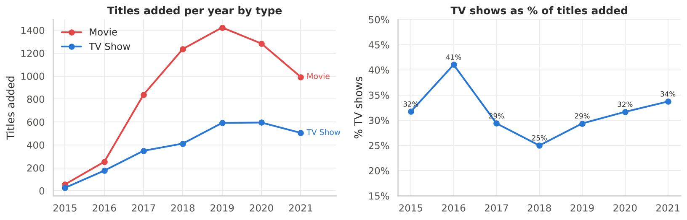
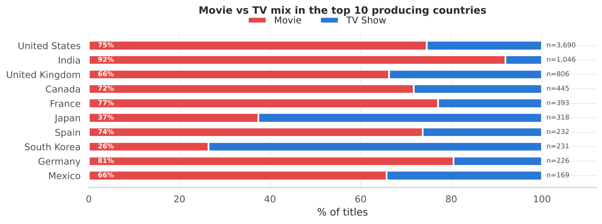
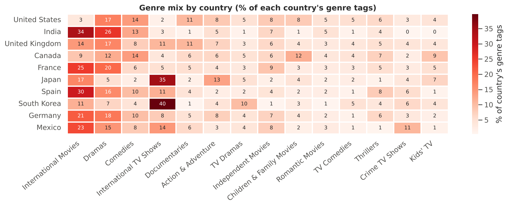
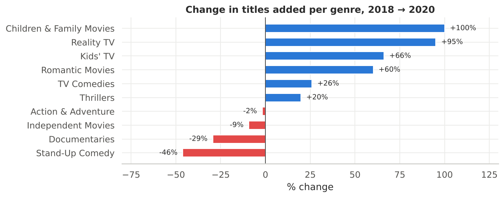
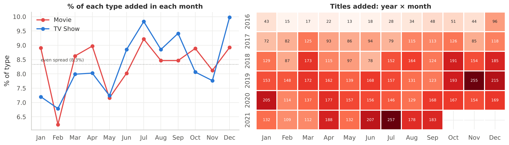

# Netflix Content Strategy: Exploratory Data Analysis

**What should Netflix produce next, and where should it grow?** An end-to-end exploratory data analysis of 8,807 Netflix movies and TV shows that turns a raw catalogue into data-backed content and market recommendations for business leaders.


| | |
|---|---|
| 🖥️ **Interactive dashboard** | [`dashboard/`](dashboard/) (static site, deploy on Vercel with Root Directory `dashboard`) |
| 📓 **Notebook** | [`notebooks/Netflix_EDA_Case_Study.ipynb`](notebooks/Netflix_EDA_Case_Study.ipynb) (fully executed, all outputs saved) |
| 📄 **Report (PDF, 33 pages)** | [`reports/Netflix_EDA_Case_Study.pdf`](reports/Netflix_EDA_Case_Study.pdf) |
| 🌐 **Report (HTML)** | [`reports/Netflix_EDA_Case_Study.html`](reports/Netflix_EDA_Case_Study.html) |
| 📝 **Insights & recommendations (one page)** | [`reports/insights_and_recommendations.md`](reports/insights_and_recommendations.md) |
| 📊 **23 charts** | [`images/`](images/) |
| 🗂️ **Raw + cleaned data** | [`data/`](data/) |

---

## 1. Business problem

Netflix has 222M+ subscribers and over 8,000 titles. Every new show or movie is a large investment. Using the catalogue as of September 2021, this project answers:

1. Is Netflix shifting from movies to TV shows?
2. How has content volume changed over the last 30 years?
3. Which genres, audiences and durations dominate, and which are growing?
4. What content is available in each country, and which markets are rising?
5. Who are the key actors and directors per content type and market?
6. When is the best time to launch a show or movie?

## 2. Key findings

| # | Finding | Evidence |
|---|---|---|
| 1 | **Netflix is pivoting to TV** | TV share of new additions: **25% (2018) → 34% (2021)**; titles released in 2021: **315 TV vs 277 movies** |
| 2 | **Growth has plateaued** | Additions peaked at **2,016 (2019)**, then 1,879 (2020) |
| 3 | **Adult-first library with a family gap** | 46% adult-rated; only **6.5%** for little kids, yet kids & family genres grew **+66% to +100%** (2018→20) |
| 4 | **Three markets = 59% of titles** | US 3,690 · India 1,046 · UK 806 |
| 5 | **Each country has a content personality** | India **92% movies**; South Korea **74% TV** (K-dramas); Japan **63% TV** (anime); Mexico/Spain over-index on **crime & thrillers** |
| 6 | **New frontiers** | Nigeria **1 → 42** titles/yr, Egypt **3 → 54** (2018→20); Japan & Korea **+70–80%** |
| 7 | **Most shows end after one season** | **67%** of TV shows have exactly 1 season |
| 8 | **The sweet-spot movie is ~1.5–2 h** | Median **98 min**, middle 50% **87–114 min**; newer films getting shorter |
| 9 | **Friday is launch day** | **35%** of TV shows and 26% of movies are added on a Friday; Jul & Dec are peak TV months |
| 10 | **TV = originals, movies = licensing** | TV reaches Netflix in the release year (median 0 yrs); movies after ~2 yrs |

<p align="center">
  <br>
  <br>
  <br>
  <br>
  
</p>

## 3. Recommendations (plain language)

1. **Make more TV series**, especially international dramas, crime and kids' shows.
2. **Renew good shows**: two in three stop after season 1; set clear renewal rules for shows people finish.
3. **Grow family and kids' content**: only 1 in 15 titles is for little kids, yet it is one of the fastest-growing areas.
4. **Go local, country by country:** Indian movies with local stars plus web-series; anime from Japan; K-dramas from Korea; Spanish-language crime and thrillers from Mexico and Spain; partner with studios in fast-growing **Nigeria and Egypt**.
5. **Keep movies at 90–110 minutes**; kids' movies around an hour.
6. **Launch big shows on a Friday in July or December**; avoid February for big launches.
7. **Invest in growing genres** (reality, romance, action, kids); be selective with stand-up and documentaries.
8. **Co-produce to enter new markets**: 15% of titles already involve 2+ countries.
9. **Add well-known classic films selectively** to attract older audiences cheaply.
10. **Pair this catalogue view with viewing data** and review these bets every quarter.

## 4. Analysis workflow

```
Raw CSV ─► Cleaning ─► Profiling ─► Un-nesting ─► Univariate ─► Bivariate ─► Outliers ─► Insights ─► Recommendations
```

| Step | What was done |
|---|---|
| **Cleaning** | Fixed 3 rows where duration was typed into `rating`; trimmed text; parsed `date_added`; split `duration` into number + unit (minutes vs seasons) |
| **Feature engineering** | `year_added`, `month_added`, `weekday_added`, `years_to_netflix`, `audience` (14 ratings → Little Kids / Older Kids / Teens / Adults), `release_era` |
| **Data types** | `type`, `rating`, `audience`, `duration_unit`, `weekday_added` converted to (ordered) `category` (memory 9.7 MB → 7.5 MB) |
| **Missing values** | `director` 29.9% (91% of TV shows, structural), `cast` 9.4%, `country` 9.4%; filled with "Unknown" and excluded from rankings; no rows dropped |
| **Un-nesting** | `cast`, `director`, `country`, `listed_in` exploded to one row per value → 36,439 actors, 4,993 directors, 122 countries, 42 genres |
| **Visuals** | Countplots, histograms + KDE (distplot), boxplots, line trends, stacked bars, heatmaps, correlation matrix |
| **Outliers** | IQR fences on movie duration (7.3% outliers), seasons, release year, years-to-Netflix; kept as genuine titles, medians reported |

## 5. Repository structure

```
├── data/
│   ├── netflix.csv                      # original dataset (8,807 × 12)
│   └── processed/
│       ├── netflix_cleaned.csv          # cleaned + engineered features
│       └── netflix_{cast,director,country,genre}_unnested.csv
├── notebooks/
│   └── Netflix_EDA_Case_Study.ipynb     # full analysis, executed
├── reports/
│   ├── Netflix_EDA_Case_Study.pdf       # submission-ready PDF (33 pages)
│   ├── Netflix_EDA_Case_Study.html      # same report, browser-friendly
│   └── insights_and_recommendations.md  # text for the submission editor
├── dashboard/                           # interactive web dashboard (Vercel-ready)
├── images/                              # 23 charts saved with plt.savefig
├── scripts/export_pdf.sh                # re-run notebook and export reports
├── requirements.txt
└── LICENSE
```

## 6. Run it yourself

```bash
git clone https://github.com/dot-hpg/netflix-content-insights.git
cd netflix-content-insights
python -m venv .venv && source .venv/bin/activate   # Windows: .venv\Scripts\activate
pip install -r requirements.txt
jupyter notebook notebooks/Netflix_EDA_Case_Study.ipynb
```

Run all cells; the charts are written to `images/` and the cleaned tables to `data/processed/`. `scripts/export_pdf.sh` re-executes the notebook and regenerates the reports.

## 7. Dataset

Netflix titles dataset (as of 25 Sep 2021), provided by Scaler for the *Netflix: Data Exploration and Visualisation* business case. Columns: `show_id`, `type`, `title`, `director`, `cast`, `country`, `date_added`, `release_year`, `rating`, `duration`, `listed_in` (genre), `description`.

**Limitation:** the data shows what is *available* on Netflix, not what people *watch*. Without viewing hours or revenue, "more titles" signals Netflix's investment choices rather than proven demand. 2021 covers January to September only.

## 8. Skills demonstrated

Problem framing · data cleaning & validation · feature engineering · handling nested/multi-valued fields · missing-value strategy · univariate, bivariate & multivariate EDA · outlier detection (IQR) · data storytelling for non-technical stakeholders · reproducible notebooks

---

**Guntuku Hariprasad** · [GitHub @dot-hpg](https://github.com/dot-hpg)
